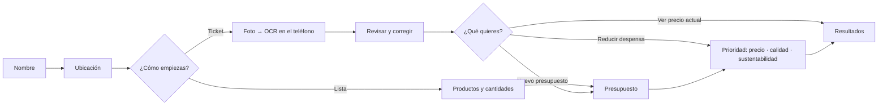
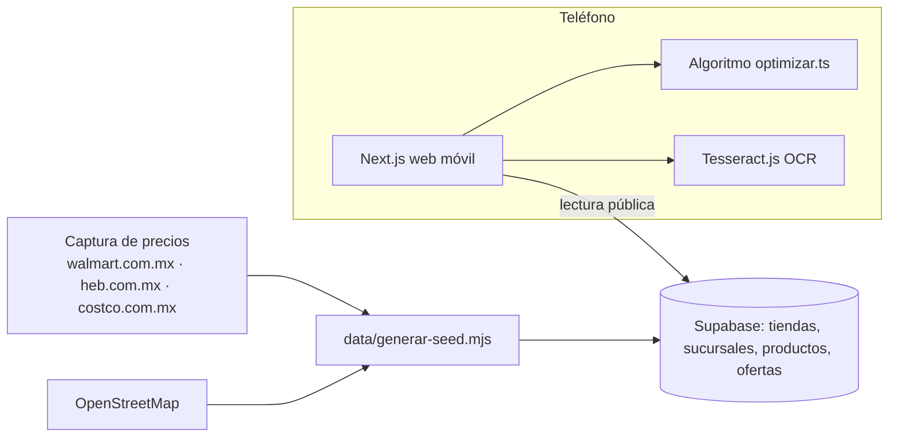

# GreenPath 🌿

**Tu despensa al mejor precio, con calidad y sustentabilidad, en Monterrey.**

Le das a GreenPath tu lista de despensa o la foto de tu ticket, tu presupuesto y tu ubicación. Te dice en qué tienda (Walmart, H-E-B o Costco) o combinación de tiendas te conviene comprar, cuánto ahorras y qué productos elegir para subir de calidad o de sustentabilidad sin salirte del presupuesto.

## Flujo

## Arquitectura

## Algoritmo
1. **Lo más barato primero.** Por cada producto calcula cuántos paquetes necesitas y el costo en cada tienda.
2. **Si sobra presupuesto,** sube la calidad (P) o la sustentabilidad (S) donde cada peso extra da más puntos.
3. **Si ni lo más barato alcanza,** quita paquetes del renglón más caro hasta caber y te dice qué ajustó.
4. **Compara** cada tienda sola y cada pareja. Ordena por cobertura, presupuesto, nivel y total, y te dice la sucursal más cercana.

## Niveles
- **Calidad:** P1 Premium · P2 Superior · P3 Estándar · P4 Económica.
- **Sustentabilidad:** S1 Alta · S2 Buena · S3 Convencional · S4 Alto impacto.

Reglas y fuentes: [`data/README.md`](data/README.md).

## Estructura
| Carpeta | Qué hace |
|---|---|
| `app/` | Web móvil (Next.js + Tailwind). |
| `data/` | Precios capturados, sucursales OSM y generador del catálogo. |
| `supabase/` | Migraciones de la base de datos. |

## Fuentes y licencias
- **Precios:** consultados en línea el 12-nov-2026. En tienda pueden variar.
- **Sucursales:** © colaboradores de OpenStreetMap (ODbL).
- **Huella por alimento:** Poore & Nemecek (2018) vía Our World in Data (CC BY).
- **OCR:** Tesseract.js (Apache-2.0).

Avance y decisiones: [`PROGRESO.md`](PROGRESO.md).
