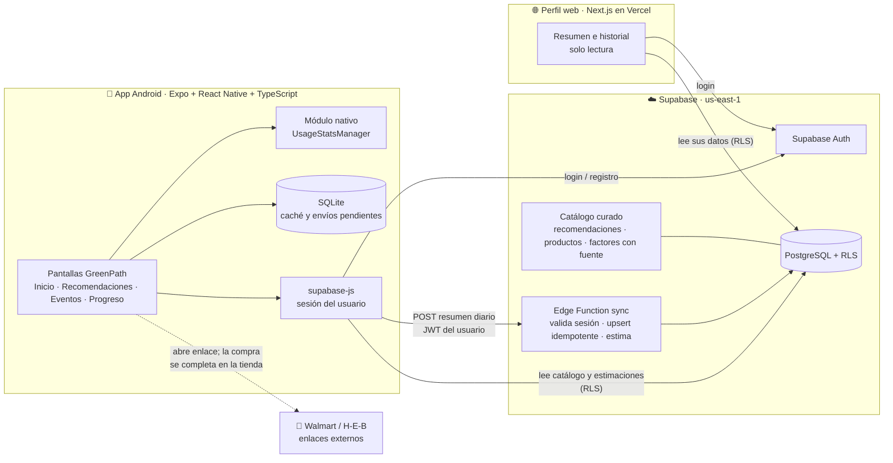
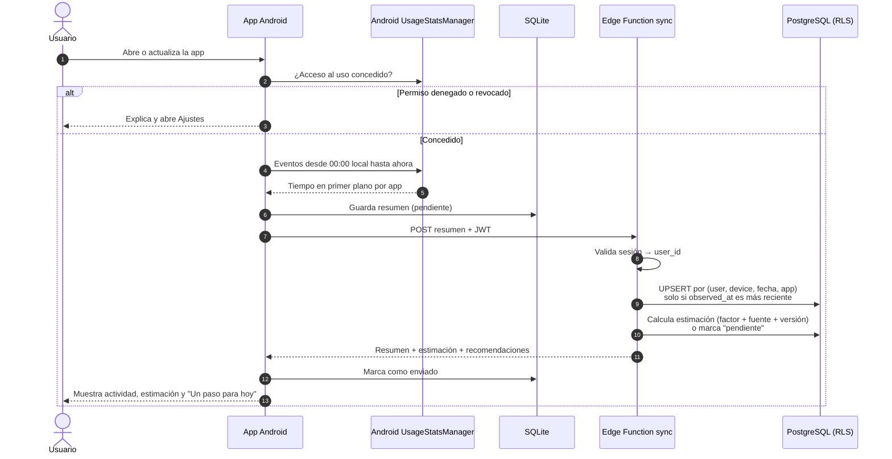
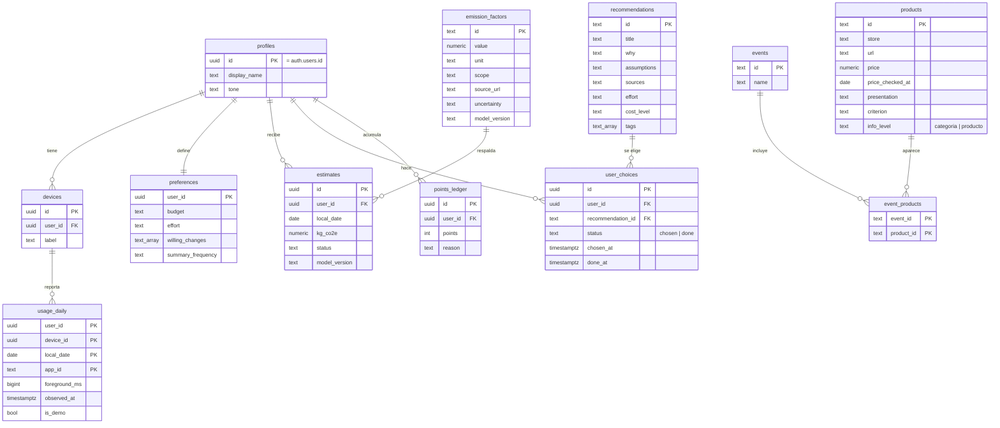

# GreenPath 🐻🌿

> **Haz visible tu impacto y encuentra cambios que sí van contigo.**

GreenPath es una app para reducir emisiones de carbono mediante decisiones cotidianas realistas. Registra automáticamente parte de tu actividad (uso de aplicaciones en Android), estima su impacto **solo cuando existe un factor defendible** y propone cambios filtrados por tu presupuesto, tu esfuerzo y lo que estás dispuesto a cambiar.

Proyecto de hackatón · Monterrey, Nuevo León · Entrega: 13 de noviembre de 2026, 9:00 a. m. (America/Mexico_City)

Equipo: **Diego** y **Scar**.

---

## Índice

1. [Qué hace](#qué-hace)
2. [Principios](#principios)
3. [Arquitectura](#arquitectura)
4. [Flujo de sincronización](#flujo-de-sincronización)
5. [Modelo de datos](#modelo-de-datos)
6. [Contrato de sincronización v1](#contrato-de-sincronización-v1)
7. [Modelo ambiental](#modelo-ambiental)
8. [Pantallas y recorrido](#pantallas-y-recorrido)
9. [Identidad visual](#identidad-visual)
10. [Estado del proyecto](#estado-del-proyecto)
11. [Estructura del repositorio](#estructura-del-repositorio)
12. [Cómo ejecutarlo](#cómo-ejecutarlo)
13. [Código de terceros y licencias](#código-de-terceros-y-licencias)

---

## Qué hace

La app tiene **tres pestañas** (MVP v2):

| Pestaña | Qué hace | Código |
|---|---|---|
| **📊 Mi impacto** | El **Monitor**: capta el uso de apps en Android y lo transforma en datos comprensibles (tiempo por app, guardado en Supabase). Huella digital: "pendiente" (no se deduce CO₂ de minutos). Incluye una **calculadora manual de electricidad** (kWh × factor que aporta el usuario con fuente). | `screens/MonitorScreen`, `features/usage`, `features/sync`, `features/carbon` |
| **🌱 Reducir** | Puerta a: **🍎 Mi alimentación** (despensa local de 12 ingredientes y 6 recetas para aprovechar lo que tienes) y **🎉 Mis eventos: carne asada** (compara 3 menús con CO₂e estimado por factores publicados, presupuesto, y seguimiento de comprado / consumido / guardado / desechado). También muestra el catálogo de recomendaciones. | `screens/ReduceScreen`, `screens/FoodScreen`, `screens/EventsScreen`, `features/food`, `features/carbon`, `features/foodLedger`, `features/eventStorage` |
| **🏆 Mi progreso** | Barra de puntos por nivel. Puntos por % de reducción del **tiempo de uso promedio por día** (últimos 7 días vs. 7 anteriores), calculados en el servidor. **No es reducción de CO₂.** Patrocinadores: próximamente. | `screens/RewardsScreen`, `features/rewards` |

Metodología de carbono (factores, alcance, niveles de evidencia): [`docs/CARBON_METHODOLOGY.md`](docs/CARBON_METHODOLOGY.md).

| Nivel de evidencia | En la app |
|---|---|
| **Medido** | Tiempo de apps (Android); invitados y gramos autodeclarados |
| **Estimado** | CO₂e de alimentos con factores globales Poore & Nemecek (2018) vía Our World in Data; escenario eléctrico manual |
| **Potencial** | Diferencia entre menús hipotéticos (no es reducción conseguida) |
| **Reducción conseguida** | No disponible en el MVP |

Detalle de funciones:

| Función | Descripción | Alcance para la demo |
|---|---|---|
| **Actividad digital automática** | Con autorización, lee el tiempo de uso por aplicación en Android (`UsageStatsManager`). Sin captura manual. Se consulta al abrir o actualizar la app. | Indispensable |
| **Recomendaciones aplicables** | Catálogo curado + reglas (sin IA). Filtra por situación, presupuesto, preferencias y esfuerzo. Cada una explica qué hacer, por qué podría reducir emisiones, con qué datos y supuestos, y qué esfuerzo o gasto supone. Botones **“Esto sí va conmigo”** y **“Ver otra opción”**. | Indispensable |
| **Eventos y compras** | Carnes asadas y fiestas: productos curados con enlace a Walmart o H‑E‑B, precio consultado con fecha y presentación, y criterio ambiental. La compra se completa en la tienda. | Indispensable (carne asada) |
| **Progreso** | Muestra por separado: *decisiones elegidas*, *acciones realizadas*, *puntos* y *huella estimada de las actividades registradas*. Comparación de los últimos 7 días contra los 7 anteriores cuando los periodos son comparables. | Indispensable (comparación con historial de demostración identificado) |
| **Perfil web** | Misma cuenta que en el móvil: resumen e historial, consultable desde computadora o celular (incluido iPhone). | Indispensable |
| **Fotografías** | Subir una foto, elegir categoría y confirmar el producto para encontrar alternativas del catálogo. **Sin reconocimiento automático.** | Ampliación |
| **Resúmenes periódicos** | Frecuencia diaria, semanal, quincenal o mensual. | Se guarda la preferencia; el envío es ampliación |
| **Beneficios de negocios locales** | Promociones de negocios cercanos a la universidad. | En exploración: **sin acuerdos confirmados** |
| iOS, GPS, reconocimiento de imágenes | — | Etapas posteriores |

## Principios

- **Medido ≠ estimado ≠ desconocido.** Toda pantalla distingue *actividad registrada*, *emisiones estimadas* e *información insuficiente para calcular*.
- **No inventamos factores.** El tiempo en una app no revela bytes transferidos ni energía consumida. Sin un factor con fuente primaria, mostramos la actividad y la estimación queda **pendiente**.
- **Elegir no es hacer.** “Esto sí va conmigo” registra una intención, no una reducción. Visitar un enlace no demuestra una compra.
- **Menos datos no es menos huella.** Registrar menos información no se interpreta como reducir emisiones.
- **Huella de lo registrado, no huella total.** Nunca afirmamos conocer la huella completa de una persona.
- **Sin culpa.** La mascota acompaña y motiva; no atribuimos daños concretos a animales o parques a partir de nuestros cálculos.
- **No confundimos** gases de efecto invernadero, residuos y calidad del aire.
- **Nada se presenta como terminado** (integraciones, cálculos, alianzas) sin haberse verificado.

## Arquitectura



**Decisiones clave**

- **Android primero.** iOS no permite leer el uso de otras apps de forma equivalente; queda para después.
- **Compilación propia** (`expo run:android` / APK). Expo Go no carga módulos nativos personalizados.
- **El servidor obtiene el usuario de la sesión validada**, nunca del cuerpo de la petición.
- **El cálculo ambiental vive en el servidor**, para que móvil y web muestren lo mismo.
- **RLS** limita a cada usuario a sus propios registros.
- Si el despliegue de la Edge Function se bloquea, el plan B es una función RPC de Postgres con la misma lógica.

## Flujo de sincronización



**Idempotencia.** Cada envío es una *foto acumulada del día*, no un incremento: reemplaza al anterior y nunca se suma. Repetir la sincronización no duplica tiempos, y un resumen más antiguo (`observed_at` menor) no sobrescribe uno reciente. Los dispositivos se muestran por separado; no se suman como si fueran tiempo exclusivo de una persona.

## Modelo de datos



Puntos, decisiones elegidas, acciones realizadas y emisiones estimadas viven en tablas distintas y se muestran por separado.

## Contrato de sincronización v1

`POST /functions/v1/sync` con `Authorization: Bearer <JWT del usuario>`

```json
{
  "schema_version": 1,
  "device_id": "uuid-v4 generado al instalar",
  "device_label": "Pixel 6 (emulador)",
  "timezone": "America/Mexico_City",
  "local_date": "2026-11-12",
  "period_start": "2026-11-12T00:00:00-06:00",
  "period_end": "2026-11-12T14:30:00-06:00",
  "observed_at": "2026-11-12T14:30:05-06:00",
  "source": "android_usagestats",
  "items": [
    { "app_id": "com.whatsapp", "app_label": "WhatsApp", "foreground_ms": 1834000 }
  ]
}
```

| Campo | Regla |
|---|---|
| `user_id` | **Nunca** viaja en el cuerpo: se obtiene del JWT validado. |
| `foreground_ms` | Entero ≥ 0, en **milisegundos**. |
| Clave única | `(user_id, device_id, local_date, app_id)` |
| Reemplazo | `ON CONFLICT DO UPDATE ... WHERE excluded.observed_at > usage_daily.observed_at` |
| `is_demo` | `true` en cualquier dato de demostración; la interfaz lo etiqueta. |

## Modelo ambiental

- **Actividad registrada** (minutos por app) y **emisiones estimadas** se guardan por separado.
- Cada estimación guarda **factor, unidad, alcance, fuente, supuestos, incertidumbre y `model_version`**.
- **No existe un factor de CO₂ por minuto para cada app**, y no lo inventamos. [CO2.js](https://github.com/thegreenwebfoundation/co2.js) estima a partir de **bytes transferidos**, no de minutos; solo lo usaríamos si medimos bytes.
- Se evita el doble conteo entre dispositivo, red y centros de datos declarando el alcance de cada factor.
- Las equivalencias visuales (p. ej. “cargas de celular”) solo se muestran con una conversión documentada.
- En productos se compara por **categoría** con fuentes compatibles; no afirmamos que una marca emite menos por su empaque o publicidad. Sin cantidades no calculamos la huella total de un evento.

Fuentes y factores: `docs/metodologia.md` *(en preparación)*.

## Pantallas y recorrido

| # | Pantalla | Contenido |
|---|---|---|
| 1 | Bienvenida y cuenta | Mascota, registro o inicio de sesión |
| 2 | ¿Qué va contigo? | Presupuesto, esfuerzo, cambios dispuestos, tono de las explicaciones |
| 3 | Permiso de uso | Por qué se pide, acceso a Ajustes, estados de denegado o revocado |
| 4 | Inicio · “¿Qué se arma?” | Actividad registrada, huella estimada o pendiente, “Un paso para hoy”, puntos |
| 5 | Actividad digital | Barras por app; 7 contra 7 si es comparable |
| 6 | Recomendación | Qué, por qué, datos y supuestos, esfuerzo y gasto; “Esto sí va conmigo” / “Ver otra opción” |
| 7 | Eventos | Carne asada / fiesta: productos, tienda, precio con fecha, criterio |
| 8 | Progreso | Elegidas · realizadas · puntos · emisiones estimadas; frecuencia de resúmenes |
| W | Web | Resumen e historial |

**Recorrido de la demo:** registro → preferencias → permiso → inicio con uso real → “Un paso para hoy” → “Esto sí va conmigo” → marcar realizada → progreso → carne asada → producto en H‑E‑B → misma cuenta en la web.

## Identidad visual

Lúdica y cercana, con **identidad propia** (inspirada en apps de aprendizaje gamificadas, sin copiar sus recursos):

- **Mascota:** un oso negro amigable, especie presente en la Sierra Madre Oriental de Nuevo León.
- **Tipografía:** [Nunito](https://fonts.google.com/specimen/Nunito) (SIL Open Font License).
- **Colores: verdes oscuros y claros** (definidos en `mobile/src/theme/colors.ts`):

  | Token | Color | Uso |
  |---|---|---|
  | `forest` | `#0F3D2E` | Títulos, cabeceras, barra de pestañas |
  | `pine` | `#1B5E3F` | Relieve y estado presionado de botones |
  | `leaf` | `#2E9E5B` | Botones y acciones principales |
  | `sprout` | `#A8E6B8` | Chips seleccionados, barras de gráficas |
  | `mint` | `#DDF3E4` | Tarjetas suaves |
  | `mist` | `#F1FAF3` | Fondo general |
  | `celebrate` | `#F2C94C` | Solo logros y celebraciones |
  | `pending` | `#7A8F82` | “Estimación pendiente” (nunca rojo) |
- **Componentes:** botones grandes con relieve que se hunden al pulsar, tarjetas suaves, mensajes breves.
- **Lenguaje:** “¿Qué se arma?”, “Un paso para hoy”, “Esto sí va conmigo”. Se adapta el tono sin infantilizar a los adultos.

## Estado del proyecto

Leyenda: ✅ probado · 🔧 en desarrollo · 📋 planeado · 🔍 en exploración

| Componente | Estado |
|---|---|
| Entorno Android (JDK 17, SDK 36, emulador API 35 con aceleración) | ✅ probado |
| App Expo base (Expo SDK 58, RN 0.88) | ✅ compila e instala en el emulador |
| Lectura de uso (Monitor) con `expo-android-usagestats` | ✅ probado en emulador Android 15: permiso, lectura real, aumento tras usar otra app, revocación. Pendiente: teléfono real |
| Supabase: auth, tablas, RLS | 📋 |
| Edge Function `sync` | 📋 |
| Catálogo de recomendaciones y productos | 📋 |
| Perfil web | 📋 |
| Fotografías con categoría manual | 📋 ampliación |
| Beneficios de negocios locales | 🔍 sin acuerdos |

## Estructura del repositorio

Cada carpeta tiene un `README.md` que explica qué contiene. El avance día a día está en [`PROGRESO.md`](PROGRESO.md).

```
greenpath/
├── README.md                 Este documento
├── PROGRESO.md               Bitácora: decisiones, pruebas, pendientes, siguiente paso
├── shared/
│   └── contrato/             Contrato de sincronización (esquema JSON v1)
├── mobile/                   App Android (Expo + React Native + TypeScript)
│   ├── assets/               fonts/ · mascot/
│   └── src/
│       ├── screens/          Una pantalla por archivo
│       ├── navigation/       Flujo entre pantallas
│       ├── features/         Lógica por función
│       │   ├── auth/             Cuenta y sesión
│       │   ├── usage/            Permiso y lectura de uso de apps
│       │   ├── sync/             Envío al servidor y pendientes
│       │   ├── preferences/      Presupuesto, esfuerzo, tono
│       │   ├── recommendations/  Catálogo filtrado y elecciones
│       │   ├── events/           Carne asada, fiesta, productos
│       │   ├── progress/         Elegidas, realizadas, puntos, estimación
│       │   └── photos/           Ampliación: foto + categoría
│       ├── components/       ui/ · charts/ · mascot/
│       ├── lib/              Supabase, SQLite, fechas
│       ├── theme/            Colores y tipografía
│       └── types/            Tipos y contrato
├── supabase/
│   ├── migrations/           Esquema, RLS y funciones SQL
│   ├── functions/sync/       Edge Function de sincronización
│   ├── seed/                 Catálogo y datos demo marcados
│   └── tests/                Pruebas de RLS e idempotencia
├── web/                      Perfil web (Next.js, Vercel)
└── docs/
    ├── arquitectura/         Contratos y decisiones técnicas
    ├── metodologia/          Factores, fuentes, incertidumbre
    ├── catalogo/             Criterios de recomendaciones y productos
    ├── producto/             Pantallas, lenguaje, identidad visual
    └── pitch/                Presentación
```

## Cómo ejecutarlo

**Requisitos:** Node 20+, JDK 17, Android SDK (plataforma 36) y un emulador o teléfono Android con depuración USB.

```bash
cd mobile
npm install
npx expo run:android      # compila e instala la app en el emulador o teléfono
```

En el dispositivo: **Ajustes → Acceso al uso → GreenPath → Permitir**.

Variables de entorno (`mobile/.env`, no se versiona):

```
EXPO_PUBLIC_SUPABASE_URL=...
EXPO_PUBLIC_SUPABASE_ANON_KEY=...
```

## Código de terceros y licencias

| Proyecto | Uso | Licencia | Versión |
|---|---|---|---|
| [expo-android-usagestats](https://github.com/PriyavKaneria/expo-android-usagestats) | Lectura de estadísticas de uso | MIT | 1.2.0 |
| [Expo](https://github.com/expo/expo) / React Native | Base de la app | MIT | SDK 58 / 0.88 |
| [Supabase](https://github.com/supabase/supabase) | Auth, base de datos, funciones | Apache 2.0 | — |
| [Next.js with-supabase](https://github.com/vercel/next.js/tree/canary/examples/with-supabase) | Plantilla del perfil web | MIT | 📋 |
| [react-native-gifted-charts](https://github.com/Abhinandan-Kushwaha/react-native-gifted-charts) | Gráficas móviles | MIT | 📋 |
| [Nunito](https://fonts.google.com/specimen/Nunito) | Tipografía | OFL 1.1 | — |

Referencias de experiencia, **sin reutilizar su código** (licencias GPL incompatibles con nuestro uso): [NMF.earth](https://github.com/NMF-earth/nmf-app), [Mindful](https://github.com/akaMrNagar/Mindful).
