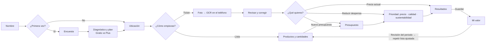
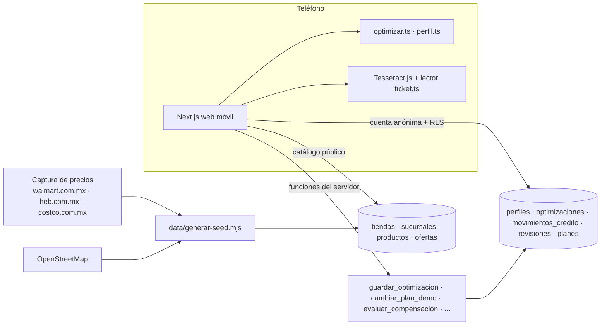

# GreenPath 🌿

**Gasta menos en tu despensa y reduce tu huella de carbono, con precios reales de Monterrey.**

GreenPath recibe tu lista de despensa o la foto de tu ticket, tu presupuesto y tu ubicación. Te dice en qué tienda (Walmart, H-E-B o Costco), o en qué combinación de tiendas, te conviene comprar y cuánto ahorras. También te dice qué productos elegir para subir de calidad o de sustentabilidad sin salirte del presupuesto, y cómo baja tu huella con alternativas equivalentes.

- **App publicada:** https://coolproject-henna.vercel.app/ (web para celular).
- **Avance, decisiones y pruebas:** [`PROGRESO.md`](PROGRESO.md).

## Qué hace
| Área | Funciones |
|---|---|
| **Encuesta inicial** (una vez) | Uso (hogar, evento, negocio), personas, frecuencia, gasto, problemas y qué no cambiarías (marcas, calidad, restricciones, supermercados). Se edita desde Mi valor. |
| **Diagnóstico y plan** | Reglas transparentes, sin IA generativa y sin inventar ahorros. Recomienda Gratis, Plus, análisis individual, Eventos o Negocios según tu frecuencia y tu gasto. |
| **Despensa** | Lista escrita o foto del ticket (el OCR se hace en el teléfono). Revisas y corriges, eliges presupuesto y prioridad (precio, calidad o sustentabilidad) y ves los resultados. |
| **Resultados** | Recomendación por tienda o pareja de tiendas y la sucursal más cercana. Tu lista habitual contra la optimizada, en pesos y CO₂e, respetando tus preferencias. Alternativas **ganar-ganar** que bajan costo y CO₂e, y un tip distinto para reducir CO₂ en cada resultado. |
| **Planes (demo, sin cobros)** | **Gratis** $0: comparación básica · **Individual** $29 por análisis completo · **Flex** $59/mes (2 análisis) · **Plus** $99/mes (4 análisis). Se recomienda el plan con mayor beneficio neto calculado con tu lista habitual y precios reales; si no hay beneficio, Gratis. |
| **Dashboard** | En Mi valor: lo que disminuiste por producto en cada despensa, en pesos y kg CO₂e (barras y tabla). |
| **Mi valor GreenPath** | Ahorro **estimado** contra ahorro **comprobado** (lo que registras que pagaste), desperdicio, costo de Plus y beneficio neto. También huella, historial, revisión del periodo (ajusta tu siguiente lista), créditos, cancelar Plus y borrar tus datos. |
| **Cuenta** | Anónima: sin correo ni contraseña. El botón "Cerrar sesión" está en las pantallas de inicio. |

## Flujo

## Arquitectura

## Algoritmo de despensa
1. **Preferencias primero.** Se limita a tus supermercados, quita la calidad estándar si no quieres bajarla, respeta sin lactosa, vegetariano y tus marcas, y aplica las alternativas que aceptaste.
2. **Lo más barato.** Por cada producto calcula los paquetes necesarios y el costo en cada tienda.
3. **Si sobra presupuesto** (Plus), sube calidad o sustentabilidad (S) donde cada peso extra da más puntos.
4. **Si ni lo más barato alcanza,** quita paquetes del renglón más caro y te dice qué ajustó.
5. **Compara** cada tienda sola y cada pareja (Plus). Ordena por cobertura, presupuesto, nivel y total.
6. **Alternativas ganar-ganar.** Busca sustitutos equivalentes en tu lista: proteína (res, pollo, jamón, salchicha, frijol, lentejas), bebida (leche, bebida de avena), guarnición (arroz, papa, pasta) y tortilla (maíz, harina). Los compara con la misma cantidad y el precio más bajo en tus tiendas. Primero propone los que **bajan costo y CO₂e a la vez**, luego los que solo bajan CO₂e. **Nunca propone más huella.** Tú aceptas o rechazas; lo rechazado no se repite.
7. **Referencia justa.** Compara contra tu ticket o contra la misma lista en tu súper habitual. Si aceptaste alternativas, lo dice.

## Lector de ticket
- Aprende del catálogo: cada título capturado es un ejemplo. Las palabras raras y las marcas pesan más, y las abreviaturas se leen como prefijo.
- Aprende de tus correcciones, que se guardan en el teléfono.
- Lee las columnas cantidad, precio unitario y total.
- Con el ticket real de H-E-B reconoce 6 de 6 renglones.

## Niveles y huella
- **Calidad:** Premium · Superior · Normal · Estándar (gris).
- **Sustentabilidad:** S1 Alta · S2 Buena · S3 Convencional · S4 Alto impacto.
- **CO₂e** = cantidad × factor por tipo de alimento (Poore & Nemecek 2018, vía Our World in Data). Se presenta como **reducción potencial**, no como emisiones evitadas comprobadas.

Reglas y fuentes completas: [`data/README.md`](data/README.md).

## Estructura
| Carpeta | Qué hace |
|---|---|
| [`app/`](app/README.md) | Web móvil (Next.js + Tailwind): pantallas, lógica y pruebas. |
| [`data/`](data/README.md) | Precios capturados, sucursales de OSM, productos y generador del catálogo. |
| [`supabase/`](supabase/README.md) | Migraciones, configuración de auth y prueba E2E. |

## Pruebas
- `cd app && npm test`: algoritmo, lector de ticket (incluye el ticket real), perfil, plan, preferencias, alternativas, CO₂e y revisión.
- `cd app && node ../supabase/tests/planes_e2e.mjs`: contra Supabase real. Cubre plan demo, créditos sin doble cobro, compensación, RLS entre usuarios y borrado.

## Fuentes y licencias
- **Precios:** consultados en línea el 12 y 13-nov-2026. En tienda pueden variar. Costco requiere membresía.
- **Sucursales:** © colaboradores de OpenStreetMap (ODbL).
- **Huella por alimento:** Poore & Nemecek (2018) vía Our World in Data (CC BY).
- **OCR:** Tesseract.js (Apache-2.0).
